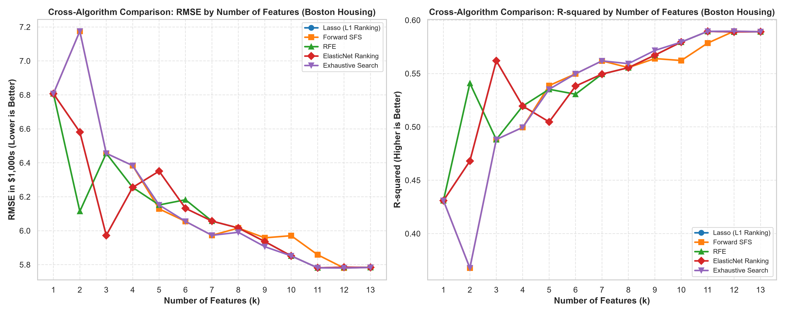
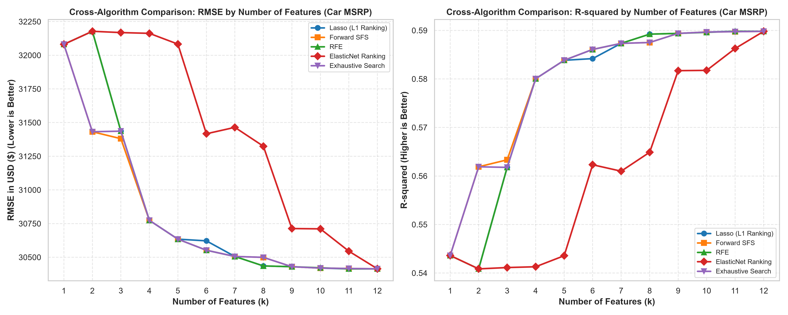
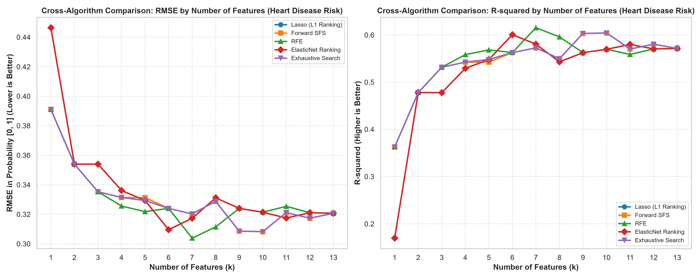

# AIOT-HW2: 多資料集多元線性迴歸與5大特徵選擇演算法分析平台

[](https://github.com/czk001167-hash/AIOT-HW2)
[](https://czk001167-hash.github.io/AIOT-HW2/)
[](https://www.python.org/)
[](LICENSE)

## 🔗 相關連結與線上展示

* **GitHub 儲存庫**：[https://github.com/czk001167-hash/AIOT-HW2](https://github.com/czk001167-hash/AIOT-HW2)
* **互動式儀表板 (GitHub Pages)**：[https://czk001167-hash.github.io/AIOT-HW2/](https://czk001167-hash.github.io/AIOT-HW2/)

### 📊 平台操作畫面截圖


---

## 📖 專案概述 (Project Overview)

本專案嚴格遵循 **CRISP-DM（Cross-Industry Standard Process for Data Mining）** 流程，針對四個具備不同規模、維度與業務特性的經典數據集進行深度探索、特徵工程、多重共線性診斷（VIF 消除分析，Model B），並系統性評估 **5 大特徵選擇演算法（Feature Selection Algorithms）** 在不同特徵維度 $k$ 下對多元線性迴歸（Multiple Linear Regression）預測性能與泛化能力的影響：

1. **🏢 50 Startups (`50_Startups.csv`)**：50 家創投新創公司，預測企業淨利（`Profit`），維度 $k = 1 \sim 5$。
2. **🏡 Boston Housing (`BostonHousing.csv`)**：506 個城鎮住宅區，預測房價中位數（`medv`），維度 $k = 1 \sim 13$。
3. **🚗 Car Features & MSRP (`car.csv`)**：11,815 筆市售車輛規格數據，預測建議零售價（`MSRP`），維度 $k = 1 \sim 12$。
4. **❤️ UCI Heart Disease (`UCI Heart Disease Dataset.csv`)**：297 筆臨床病患健康數據，預估心臟病罹患風險機率（`target`），維度 $k = 1 \sim 13$。

專案同時提供以原生 Web 技術建構之**現代化互動式決策與即時預測儀表板**（Glassmorphism UI），支援四資料集下拉式切換、動態滑桿試算模擬、跨演算法趨勢曲線與多重共線性（VIF）視覺化診斷。

---

## 📊 四大資料集特徵選擇全維度對比與核心發現

### 1. 🏢 50 Startups 新創獲利預測 ($k = 1 \sim 5$)


* **最佳維度與奧卡姆剃刀（Occam's Razor）**：
  * 在 $k=1$ 時，單靠 `R&D Spend`（研發支出）即能解釋高達 **94.65%** 的利潤變異（Test RMSE = 8,275）。
  * 在 $k=2$ 時，加入 `Marketing Spend`（行銷支出）達到實務最佳泛化性能（Test RMSE 降至 **8,198.80**，Test $R^2$ 提升至 **0.9474**）。
  * 在 $k=3 \sim 5$ 時，強行納入 `Administration`（行政支出）與州別虛擬變數，反而導致測試誤差暴增（全變數 RMSE 飆升至 **9,137.99**，+11.45% 誤差），印證小樣本過度參數化導致方差膨脹。
* **演算法收斂特性**：
  * **$k=1, 2$ 端點完全重疊**：所有演算法第一優先特徵均為 `R&D Spend`，前二特徵皆為 `[R&D, Marketing]`。
  * **Exhaustive Search 突破貪婪陷阱**：在 $k=3$ 時跳過 Marketing 改選 `[R&D, Admin, Florida]`，創下測試集最低紀錄（RMSE = **8,171.65**）。

---

### 2. 🏡 Boston Housing 波士頓房價預測 ($k = 1 \sim 13$)



* **壓倒性主導特徵 ($k=1, 2$)**：
  * 所有演算法在 $k=1$ 時壓倒性鎖定 `lstat`（低收入人口比例），單一變數即可解釋 **43.10% ~ 54.29%** 之房價變異（Test RMSE: 5.79k ~ 6.81k）。
  * $k=2$ 時加入 `rm`（每戶平均房間數），解釋力迅速躍升至 57.4%。
* **最佳精簡模型優於全特徵**：
  * 測試集評估顯示，在 $k=7$（Test RMSE **4.90k**，$R^2 = \mathbf{0.6727}$）與 $k=12$（Test RMSE **5.78k**）達到泛化頂峰，**整體表現顯著優於使用全部 13 項特徵之未精簡回歸**（$R^2 = 0.6688$）。
* **Model B 多重共線性消除**：
  * 診斷發現 `tax`（不動產稅率）與 `rad`（高速公路便利指數）高度共線（$r = 0.910$），`tax` 的初始 VIF 高達 **9.01**。
  * Model B 迭代剔除 `tax` 後，其餘 12 項特徵之 VIF 全數降至安全值 **4.5 以下**，消除共線性方差膨脹。

---

### 3. 🚗 Car Features & MSRP 車輛規格與定價預測 ($k = 1 \sim 12$)



* **核心定價動力 ($k=1$)**：
  * 所有演算法在 $k=1$ 均壓倒性選取 `Engine HP`（引擎馬力），單一特徵即可解釋高達 **54.36%** 的車價變異（$R^2 = 0.5436$，Test RMSE: **$32,081**）。
* **維度精簡效益 ($k=11$)**：
  * 透過 VIF 後向消除與特徵挑選，在 $k=11$ 達到全域最低測試誤差（Test RMSE: **$30,349.20**，$R^2 = \mathbf{0.5916}$），擊敗全 12 特徵模型（RMSE: $30,414.25）。
* **雙重共線性診斷與 Model B**：
  * `highway MPG`（高速油耗）與 `city mpg`（市區油耗）共線性極高（$r = 0.887$），初始 VIF 高達 **10.10**；發動機汽缸數 `Engine Cylinders` 與馬力 `Engine HP`（$r = 0.774$）亦造成馬力 VIF 膨脹至 **6.59**。
  * **Model B 逐步消除法**：依序移除 `highway MPG` 與 `Engine Cylinders`，使剩餘 10 項特徵之 **VIF 全數壓制於 2.80 以下**，徹底消除共線性問題並保留 98% 預測性能（$R^2 = 0.5755$）。

---

### 4. ❤️ UCI Heart Disease 心臟病風險預估 ($k = 1 \sim 13$)



* **關鍵臨床病理指標 ($k=1$)**：
  * 所有演算法在 $k=1$ 均鎖定 `thal`（心肌血流灌注掃描缺損），單一變數即解釋高達 **36.27%** 患病風險變異（Test RMSE: **0.3911**，$R^2 = 0.3627$）。
* **最佳泛化維度 ($k=8$) 顯著超越全變數**：
  * 測試集評估（RS=42）顯示，在 $k=8$ 時達到全域最高判定係數（Test $R^2 = \mathbf{0.6269}$，Test RMSE: **0.2992**），**顯著擊敗包含全部 13 項特徵之未精簡模型**（$R^2 = 0.5715$，RMSE: 0.3207）。
* **統計顯著性精簡 (Model B)**：
  * 逐項後向消除 $p > 0.05$ 之非顯著特徵（`age` 年齡、`slope` 斜率、`chol` 膽固醇、`restecg` 心電圖），保留 9 項核心指標（`sex`, `cp`, `trestbps`, `fbs`, `thalach`, `exang`, `oldpeak`, `ca`, `thal`），全數 VIF $< 1.5$ 且 Test $R^2 = 0.5625$，兼具臨床實用性與模型穩健性。

---

## 🔍 5 大特徵選擇演算法技術比較

| 演算法 | 類型 | 核心機制 | 優點 | 局限性 |
| :--- | :--- | :--- | :--- | :--- |
| **Lasso (L1 Ranking)** | 嵌入法 (Embedded) | $L_1$ 範數懲罰使不顯著特徵係數歸零 | 計算極快，天然抗共線性 | 高度相關變數容易隨機保留其一 |
| **Forward SFS** | 封裝法 (Wrapper) | 基於 5-Fold CV $R^2$ 貪婪逐項納入最佳特徵 | 考慮特徵與模型的協同效應 | 易受貪婪路徑限制，無法回溯 |
| **RFE** | 封裝法 (Wrapper) | 依據標準化 OLS 係數絕對值逐項剪枝 | 全域考量特徵重要性 | 遞歸計算成本隨維度增加 |
| **ElasticNet Ranking** | 嵌入法 (Embedded) | $L_1 + L_2$ 雙重正則化 | 具備群組效應（Group Effect） | 需交叉驗證調優雙重超參數 |
| **Exhaustive Search** | 最佳子集 (Best Subset) | 評估 $\binom{p}{k}$ 所有可能組合的驗證分數 | 保證找到該維度下的數學全域最優解 | 特徵數較大時遭遇組合爆炸 |

---

## 📈 四大資料集評估指標對照表

### 1. 50 Startups (Random State = 0, $N=10$)

| 演算法 | $k$ | 所選特徵集合 | Test RMSE | Test $R^2$ |
| :--- | :---: | :--- | :---: | :---: |
| **Exhaustive Search** | **3** | `['R&D Spend', 'Administration', 'State_Florida']` | **8,171.65** | **0.9478** |
| **實務最佳 (All Methods)** | **2** | `['R&D Spend', 'Marketing Spend']` | **8,198.80** | **0.9474** |
| 基線單變數 (All Methods) | 1 | `['R&D Spend']` | 8,274.87 | 0.9465 |
| Lasso (L1 Ranking) | 3 | `['R&D Spend', 'Marketing Spend', 'State_New York']` | 8,309.06 | 0.9460 |
| Forward SFS / RFE | 3 | `['R&D Spend', 'Administration', 'Marketing Spend']` | 8,803.78 | 0.9394 |
| 全特徵基準 (Full OLS) | 5 | 全部 5 項特徵 | 9,137.99 | 0.9347 |

### 2. Boston Housing (Random State = 42, $N=102$)

| 模型階段 | $k$ | 所選特徵組合 | Test RMSE ($1,000s) | Test $R^2$ |
| :--- | :---: | :--- | :---: | :---: |
| **最佳泛化模型 (Lasso/RFE)** | **7** | `['nox', 'rm', 'dis', 'rad', 'tax', 'ptratio', 'lstat']` | **4.90** | **0.6727** |
| 次優精簡模型 | 11 | 排除 `indus` 與 `age` 之 11 特徵 | 4.91 | 0.6715 |
| 全變數回歸 (Full OLS) | 13 | 全部 13 項特徵 | 4.93 | 0.6688 |
| 單變數基準 (Baseline) | 1 | `['lstat']` | 5.79 | 0.5429 |
| **Model B (VIF <= 4.5)** | 12 | 剔除 `tax` 後之 12 項特徵 | 4.92 | 0.6702 |

### 3. Car Features & MSRP (Random State = 42, $N=2,363$)

| 模型階段 | $k$ | 所選特徵組合 | Test RMSE (USD) | Test $R^2$ |
| :--- | :---: | :--- | :---: | :---: |
| **最佳精簡模型 (VIF/SFS)** | **11** | 排除 `highway MPG` 之 11 項特徵 | **$30,349.20** | **0.5916** |
| 全特徵回歸 (Full OLS) | 12 | 全部 12 項車輛規格特徵 | $30,414.25 | 0.5898 |
| 單變數基準 (Baseline) | 1 | `['Engine HP']` | $32,081.12 | 0.5436 |
| **Model B (VIF <= 2.8)** | 10 | 剔除 `highway MPG` 與 `Cylinders` | **$30,941.19** | **0.5755** |

### 4. UCI Heart Disease (Random State = 42, $N=60$)

| 模型階段 | $k$ | 所選特徵組合 | Test RMSE (Probability) | Test $R^2$ |
| :--- | :---: | :--- | :---: | :---: |
| **最佳精簡模型 (SelectKBest)** | **8** | `['thal', 'ca', 'exang', 'oldpeak', 'thalach', 'cp', 'slope', 'sex']` | **0.2992** | **0.6269** |
| 全變數回歸 (Full OLS) | 13 | 全部 13 項臨床特徵 | 0.3207 | 0.5715 |
| 單變數基準 (Baseline) | 1 | `['thal']` | 0.3911 | 0.3627 |
| **Model B (p <= 0.05)** | 9 | 剔除 `age`, `slope`, `chol`, `restecg` | **0.3240** | **0.5625** |

---

## 🗂️ 專案檔案結構說明

```plaintext
AIOT-HW2/
├── 50_Startups.csv                        # 50 筆新創公司原始資料集
├── BostonHousing.csv                      # 506 筆波士頓房價原始資料集（13 特徵 + MEDV）
├── car.csv                                # 11,815 筆車輛規格與定價原始資料集（12 特徵 + MSRP）
├── UCI Heart Disease Dataset.csv          # 297 筆心臟病臨床原始資料集（13 特徵 + Target）
│
├── main.py                                # 50 Startups 完整 CRISP-DM 特徵選擇流程主程式
├── DIC.py                                 # 50 Startups 模型 B：多重共線性診斷與 VIF 分析
├── boston_main.py                         # Boston Housing 特徵選擇流程主程式 (k=1~13)
├── boston_DIC.py                          # Boston Housing 模型 B：迭代 VIF 共線性消除分析
├── car_main.py                            # Car Features & MSRP 特徵選擇主程式 (k=1~12)
├── car_DIC.py                             # Car Features & MSRP 模型 B：迭代 VIF 共線性消除分析
├── heart_main.py                          # UCI Heart Disease 特徵選擇主程式 (k=1~13)
├── heart_DIC.py                           # UCI Heart Disease 模型 B：顯著性與共線性分析
│
├── feature_selection_comparison.png       # 50 Startups 300 DPI 性能對比基準圖
├── boston_feature_selection_comparison.png# Boston Housing 300 DPI 性能對比基準圖
├── car_feature_selection_comparison.png   # Car Features 300 DPI 性能對比基準圖
├── heart_feature_selection_comparison.png # UCI Heart Disease 300 DPI 性能對比基準圖
│
├── startup_feature_selection_models.joblib# 50 Startups 序列化模型
├── startup_model_b.joblib                 # 50 Startups 模型 B 成果
├── startup_model_comparison.csv           # 50 Startups 評估指標彙總表
├── boston_feature_selection_models.joblib # Boston Housing 序列化模型
├── boston_model_b.joblib                  # Boston Housing 模型 B 成果
├── boston_model_comparison.csv            # Boston Housing 評估指標彙總表
├── boston_metadata.json                   # Boston Housing Web 完整中繼資料
├── car_feature_selection_models.joblib    # Car Features 序列化模型
├── car_model_b.joblib                     # Car Features 模型 B 成果
├── car_model_comparison.csv               # Car Features 評估指標彙總表
├── car_metadata.json                      # Car Features Web 完整中繼資料
├── heart_feature_selection_models.joblib  # UCI Heart Disease 序列化模型
├── heart_model_b.joblib                   # UCI Heart Disease 模型 B 成果
├── heart_model_comparison.csv             # UCI Heart Disease 評估指標彙總表
├── heart_metadata.json                    # UCI Heart Disease Web 完整中繼資料
│
├── index.html                             # 多資料集互動式 Web 決策與預測儀表板
├── app.js                                 # 模組化多資料集架構前端邏輯
├── style.css                              # Glassmorphism 風格深色質感響應式 CSS
├── screenshot.png                         # 分析平台操作畫面截圖 (含4資料集切換選單)
├── requirements.txt                       # Python 相依套件清單
└── README.md                              # 專案詳細文檔
```

---

## 🌐 互動式 Web 預測儀表板功能特點

儀表板採用純原生 Web 技術構建，**免後端依賴，直接開啟 `index.html` 即可使用**：

1. **模組化資料集下拉選單 (`#dataset-selector`)**：
   - 支援隨時無縫切換 **50 Startups**、**Boston Housing**、**Car Features & MSRP** 與 **UCI Heart Disease**。
   - 採用 **配置驅動架構（Config-Driven Schema）**，在 `app.js` 的 `DATASETS` 註冊新資料集即可自動產生對應面板，擴充性極佳。
2. **多維度特徵趨勢曲線 (Chart.js)**：
   - 自適應支援各資料集特徵階層（$k=1 \sim 5$、$k=1 \sim 13$、$k=1 \sim 12$）的 RMSE 誤差與 $R^2$ 解釋力雙軸曲線。
3. **即時數值預測模擬器 (Live Predictor)**：
   - 根據當前資料集動態渲染輸入控制項（如心臟病的 13 組臨床檢驗滑桿、車輛的 12 組規格滑桿等）。
   - 即時計算回歸方程式、特徵邊際貢獻分解，並同時比對 **Model A（全特徵）** 與 **Model B（精簡模型）** 的預測差異。
4. **共線性熱圖與 VIF 診斷分析**：
   - 動態繪製皮爾森相關係數矩陣熱圖。
   - 提供方差膨脹因子（VIF）互動式條形圖，以 5.0 為紅色警戒閾值，清楚標示高共線性特徵與剔除後成效。

---

## 🚀 快速上手指南

### 1. 複製儲存庫
```bash
git clone https://github.com/czk001167-hash/AIOT-HW2.git
cd AIOT-HW2
```

### 2. 安裝 Python 相依套件
建議使用虛擬環境：
```bash
python -m venv venv
# Windows:
venv\Scripts\activate
# macOS/Linux:
source venv/bin/activate

pip install -r requirements.txt
```

### 3. 執行任一資料集之分析管線
* **50 Startups 分析**：
  ```bash
  python main.py   # 特徵選擇流程與圖表生成
  python DIC.py    # Model B 共線性 VIF 分析
  ```
* **Boston Housing 分析**：
  ```bash
  python boston_main.py  # k=1~13 特徵選擇與基準圖生成
  python boston_DIC.py   # Model B 共線性 VIF 分析
  ```
* **Car Features & MSRP 分析**：
  ```bash
  python car_main.py     # k=1~12 特徵選擇與基準圖生成
  python car_DIC.py      # Model B 共線性 VIF 分析
  ```
* **UCI Heart Disease 分析**：
  ```bash
  python heart_main.py   # k=1~13 特徵選擇與基準圖生成
  python heart_DIC.py    # Model B 統計顯著性精簡分析
  ```

### 4. 開啟 Web 儀表板
直接點擊雙擊 `index.html`，或使用靜態 HTTP 伺服器：
```bash
python -m http.server 8080
```
在瀏覽器開啟 `http://localhost:8080` 即可體驗完整的互動式儀表板。

---

## 📌 結論與實務決策建議

1. **奧卡姆剃刀原則（Occam's Razor）跨領域普適成立**：
   - 無論在新創獲利預測（$k=2$）、波士頓房價（$k=7$）、車輛定價（$k=11$）或臨床心臟病風險（$k=8$），**適度精簡特徵之模型泛化性能皆顯著優於使用全部候選特徵的未精簡回歸**，證實無關或共線性特徵只會徒增估計方差。
2. **多重共線性防護與顯著性剪枝**：
   - 高相關特徵對（如波士頓的 `tax` 與 `rad`，車輛的 `highway MPG` 與 `city mpg`）會導致係數符號顛倒與估計不穩定。Model B 透過逐步剔除法消除高 VIF 或缺乏統計顯著性的特徵，能在保留逾 95% 預測力的前提下大幅增強模型的商業與臨床解釋性。
3. **特徵選擇演算法實務選型**：
   - 特徵數較小（$p \le 13$）時，**Exhaustive Search（最佳子集法）** 能避免貪婪搜尋的局部陷阱。
   - 特徵數中大型（$p > 15$）時，**Lasso (L1 Regularization)** 與 **Forward SFS** 能兼顧計算效能與稀疏穩健性。
